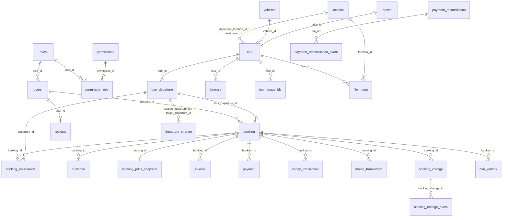

# Database SGU Tour — một file dựng đủ

`database_all.sql` là bản database tổng duy nhất của đồ án. File tự tạo database `dbtour_v2`, toàn bộ 31 bảng, khóa/index và dữ liệu demo; không cần chạy thêm migration hay SQL bổ sung.

- Định dạng: MySQL dump, `utf8mb4`, kiểm chứng trên XAMPP MariaDB 10.4.32 và MySQL 8.0.
- Dung lượng khoảng 327 KB; cập nhật lần cuối **04/11/2026**.
- Chỉ dùng cho database mới/trống. Mọi thay đổi schema trước đây đã được hợp nhất vào file này.

## Cách import

1. Dừng các service đang ghi dữ liệu và chuẩn bị **`dbtour_v2` mới/trống**. Nếu đang có dữ liệu cần giữ, export/sao lưu trước.
2. Trong phpMyAdmin, chọn Import → `database_all.sql` → UTF-8 → Go. File có lệnh tạo/chọn `dbtour_v2`, tạo bảng, khóa/index và nạp dữ liệu theo thứ tự phụ thuộc.
3. Import thành công thì chạy các service như bình thường. **Không import lại mỗi lần mở XAMPP hay khởi động đồ án.**

File cố ý báo lỗi nếu database đã có bảng. Đây là bộ dựng demo mới, không dùng để merge/nâng cấp DB đang có. Không bật tùy chọn bỏ qua lỗi SQL. DDL của MySQL có commit riêng nên nếu import bị gián đoạn, xử lý nguyên nhân rồi dựng lại trên database trống, không chạy nối qua lỗi.

`dbtour_v2` là database chuẩn của source hiện tại. Database `DBtour` cũ không còn được dùng; không import chồng lên `dbtour_v2` đang có dữ liệu.

`booking` có `ix_booking_departure (tour_departure_id)`; job nhắc hạn và đổi lịch lọc booking theo lịch khởi hành nên cần chỉ mục này. Database đã dựng trước 04/11/2026 không có nó. Khi đó chỉ chạy riêng câu lệnh sau (không import lại file, không reset dữ liệu):

```sql
CREATE INDEX ix_booking_departure ON dbtour_v2.booking (tour_departure_id);
```

## 31 bảng theo nhóm

| Nhóm | Bảng | Vai trò |
|---|---|---|
| Tài khoản và quyền | `users`, `roles`, `permissions`, `permission_role`, `invalidated_token`, `user_account_event`, `avatar_media_lock` | Tài khoản, vai trò, mã quyền `PERM:<CODE>`, token bị thu hồi, lịch sử khóa/mở khóa, khóa ghi avatar |
| Danh mục tour | `tour`, `prices`, `itinerary`, `location`, `vehicles`, `tour_departure`, `tour_image_ids`, `tour_media_lock` | Tour, bảng giá theo nhóm tuổi, lịch trình ngày, địa điểm, phương tiện, lịch khởi hành/số chỗ, ảnh tour, khóa ghi ảnh tour |
| Đặt chỗ | `booking`, `booking_reservation`, `customer`, `booking_price_snapshot`, `booking_change`, `booking_change_event`, `departure_change` | Booking, giữ/trả chỗ có hạn, hành khách, snapshot giá tại thời điểm đặt, yêu cầu dời lịch và nhật ký xử lý |
| Thanh toán và hóa đơn | `invoice`, `payment`, `vnpay_transaction`, `momo_transaction`, `payment_reconciliation`, `payment_reconciliation_event` | Hóa đơn, thanh toán nội bộ, giao dịch VNPay/MoMo, đối soát và nhật ký đối soát |
| Nội dung và hệ thống | `reviews`, `file_mgmt`, `mail_outbox` | Đánh giá sau chuyến, ảnh/avatar trên Cloudinary, hàng đợi email gửi từ booking |

## Sơ đồ quan hệ chính



Ghi chú:

- Quan hệ có khóa ngoại vật lý: `users.role_id`, `permission_role`, `booking_price_snapshot`, `booking_reservation`, `customer`, `itinerary`, `reviews`, `tour` (địa điểm/phương tiện), `tour_departure`, `tour_image_ids`.
- Các cột như `booking.account_id`, `invoice.booking_id`, `payment.booking_id`, `vnpay_transaction.booking_id`, `momo_transaction.booking_id`, `file_mgmt.tour_id/location_id` là quan hệ logic, service tự bảo đảm khi ghi.
- Bảng khóa `avatar_media_lock`, `tour_media_lock` chỉ giữ khóa ghi theo chủ thể, không chứa dữ liệu nghiệp vụ.

## Trạng thái nghiệp vụ

| Cột | Giá trị |
|---|---|
| `booking.status` | `PENDING_PAYMENT`, `CONFIRMED`, `CANCELLED`, `EXPIRED` |
| `booking_reservation.status` | `HELD`, `CHECKOUT`, `PAID`, `EXPIRED`, `CANCELLED` |
| `invoice.status` | `PAID`, `PENDING`, `REFUNDED` |
| `payment.status` | `PENDING`, `UNPAID`, `PAID`, `REFUNDED` |
| `tour_departure.operational_status` | `OPEN` và các trạng thái vận hành do admin đặt |
| `mail_outbox.status` | `PENDING`, `CLAIMED`, `DISPATCHING`, `SENT`, `RETRY`, `FAILED`, `UNKNOWN`, `SKIPPED` (kèm `attempt_count`, `next_attempt_at`, `last_error`) |

`booking_price_snapshot` giữ giá tại thời điểm đặt, nên đổi giá tour sau này không làm thay đổi hóa đơn cũ. `booking_change` lưu yêu cầu dời lịch của khách/shop, trạng thái phản hồi và thông tin hoàn tiền nội bộ; không tự chuyển tiền qua ngân hàng.

## Dữ liệu trong file

Lần kiểm chứng import ngày **27/10/2026**:

| Bảng | Số bản ghi |
|---|---:|
| Tổng số bảng | 31 |
| `roles` / `permissions` / `permission_role` | 2 / 72 / 72 |
| `users` | 12 (admin + khách cũ + 10 khách demo) |
| `tour` / `prices` | 15 / 15 |
| `tour_departure` | 715 |
| `itinerary` | 40 |
| `location` / `vehicles` / `file_mgmt` | 17 / 5 / 61 |
| `booking` / `customer` | 28 / 34 |
| `payment` / `invoice` | 23 / 23 |
| `reviews` | 15 |
| `booking_reservation` | 23 |
| `vnpay_transaction` / `mail_outbox` | 2 / 1 |

Số lịch thay đổi theo ngày import; số booking/review demo cố định. Database đang dùng có thể nhiều hơn do dữ liệu phát sinh khi test (ví dụ booking E2E còn giữ chỗ).

Nội dung chính:

- 15 tour gồm 5 tour miền Bắc mẫu ban đầu và 10 tour bổ sung, đủ giá người lớn/trẻ em/trẻ nhỏ/em bé, lịch trình, địa điểm, phương tiện và ảnh Cloudinary.
- 10 khách `user1@gmail.com` … `user10@gmail.com`; năm khách đầu có lịch sử hoàn thành tour, hóa đơn PAID và review sau ngày về.
- Booking tương lai đã thanh toán đủ loại hành khách để demo tính giá và dời lịch; thêm booking đang giữ chỗ và booking đã hết hạn/trả chỗ.
- Lịch thứ Tư, thứ Sáu, Chủ Nhật cho cả 15 tour, tính từ ngày import đến hết tháng 1 năm sau; mỗi lịch demo 36 chỗ, đã trừ số người của booking demo.
- Role `Khách Hàng` giữ mặc định đăng ký; admin có đủ 72 quyền đang định nghĩa.
- Bảng chưa phát sinh sự kiện (dời lịch, đối soát, khóa media) để trống; ứng dụng tự ghi khi sử dụng.

## Đăng nhập

| Email | Mật khẩu |
|---|---|
| `admin@example.com` | `admin123` |
| `user1@gmail.com` … `user10@gmail.com` | `user12345` |
| Khách cũ | Giữ nguyên email và mật khẩu đã có |

Mật khẩu lưu bằng BCrypt. Tài khoản demo đều `ACTIVE` để thuận tiện kiểm thử khóa/lưu trữ từ admin.

## Lưu ý dữ liệu

- Đã kiểm tra đơn vị VND: không còn giá dương nhỏ hơn 1.000 đồng; `tour.base_price` khớp `prices.adult_price`.
- Không có `txn_ref` hoặc mã ngân hàng giả. Hai giao dịch VNPay cũ được giữ; muốn demo VNPay mới thì thanh toán sandbox qua ứng dụng.
- Mail cũ đã SENT được giữ; không seed mail PENDING/RETRY và không tự gửi email lúc import. Giữ `MAIL_TEST_MODE=true` và người nhận test thuộc bạn vì các Gmail demo chỉ là định danh đăng nhập.
- SQL giữ URL Cloudinary hiện có, không upload/xóa ảnh trên Cloudinary. SMTP, Groq, Cloudinary secret và n8n credential không nằm trong SQL.
- Ba lịch cũ có `capacity=NULL` được giữ nguyên lịch sử; muốn dời các lịch này, admin cần xác nhận sức chứa theo luồng hiện tại.
- SQL trong `*/src/test/resources/` là fixture cho test/H2, **không import** vào `dbtour_v2`.

## Sau khi import

Làm theo [tổng quan hệ thống](../docs/PROJECT.md), [backend](../README.md), [frontend](../../Frontend_TourDuLich/README.md), [AI](../ai_service/README.md) và [mail/n8n](../docs/mail/README.md) để cấu hình/chạy các thành phần tương ứng.

File này là bản database tổng duy nhất; mọi thay đổi schema trước đây đã được hợp nhất, không cần chạy thêm migration.
