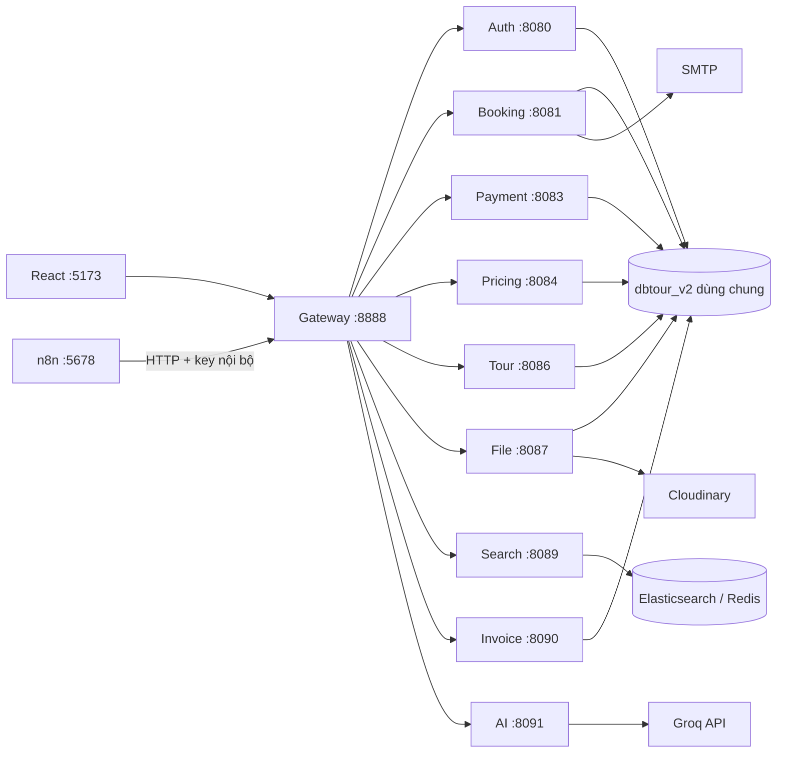

# SGU Tour — Tổng quan hệ thống

Đồ án J2EE hỗ trợ tìm tour, đặt chỗ, thanh toán VNPay sandbox, quản lý tour và tư vấn bằng AI. Tài liệu mô tả kiến trúc, nguồn dữ liệu và quy tắc nghiệp vụ hiện tại. Hướng dẫn khởi chạy được duy trì tại README từng repository.

## Chức năng hiện có

- Tài khoản: đăng ký/đăng nhập, JWT và làm mới phiên, Google Sign-In khi cấu hình OAuth, hồ sơ/avatar, role và quyền theo API; quản trị khóa, mở khóa, lưu trữ hoặc xóa tài khoản đủ điều kiện.
- Tour: danh mục, chi tiết, lịch trình, địa điểm, phương tiện, bảng giá theo nhóm tuổi, lịch khởi hành và số chỗ. Giá người lớn là giá chuẩn cho hiển thị/tìm kiếm; thanh toán tính theo từng hành khách.
- Booking: danh sách người đi, giữ/trả chỗ có hạn, hóa đơn, lịch sử đặt tour và đánh giá sau chuyến đi đủ điều kiện.
- VNPay: tạo giao dịch, kiểm tra callback/IPN và số tiền, xử lý lặp, quản lý giao dịch cần đối soát.
- Dời lịch: khách đã trả tiền gửi yêu cầu trước giờ đi tối thiểu 72 giờ; shop có luồng dời do lý do bắt buộc, phản hồi của khách và xử lý trường hợp cần hỗ trợ/hoàn tiền. Ghi nhận hoàn tiền nội bộ không tự chuyển tiền qua ngân hàng.
- Ảnh: upload từ trang admin qua file service lên Cloudinary, lưu URL/public ID, quản lý gallery/avatar và giới hạn ảnh đầu vào.
- Thông báo: Spring Email gửi từ outbox sau thao tác nghiệp vụ; n8n gọi API nội bộ để lập lượt nhắc thanh toán/khởi hành.
- AI: Spring AI gọi Groq, tìm/so sánh/đọc chi tiết tour theo dữ liệu backend, nhớ tiêu chí trong phiên, trả lời chính sách và tra cứu hạn booking của chính tài khoản.

## Kiến trúc và công nghệ

Backend gồm các ứng dụng Spring Boot độc lập, giao tiếp REST qua gateway/HTTP và sự kiện. **Runtime microservice dùng 9 database vật lý độc lập (`sgu_auth` → `sgu_reporting`) theo mô hình database-per-service**: mỗi service chỉ kết nối database của mình, không có cross-database JOIN/FK hay transaction phân tán; nhất quán giữa các service do internal API, outbox/inbox và saga đảm bảo. Biến thể `docker-compose.yml` một database `dbtour_v2` chỉ dùng cho phát triển nhanh/đối chiếu seed.

| Thành phần | Công nghệ trong source |
|---|---|
| Frontend | React 19, TypeScript 5.8, Vite 7, Ant Design 5, Redux Toolkit, Tailwind CSS 4 |
| Backend nghiệp vụ / gateway | Java 21, Spring Boot 3.2.5, Spring Cloud 2023.0.1, Security, JPA/JDBC, OpenFeign |
| AI | Spring Boot 3.5.16, Spring AI 1.1.8, Groq API |
| Database | MySQL 8.4 trong Compose; JDBC cho MySQL/MariaDB theo cấu hình |
| Tìm kiếm | Elasticsearch 8.15.0, Redis 7.2; đồng bộ snapshot từ tour service |
| Tích hợp | VNPay sandbox, Cloudinary, SMTP, n8n; Socket.IO trong auth service |

Sơ đồ thể hiện các thành phần chính, không liệt kê mọi lời gọi nội bộ. AI đọc API tour/booking, không kết nối SQL trực tiếp. Frontend Socket.IO kết nối riêng tới auth service ở cổng 8099.

## Service và cổng local

| Module | Cổng | Context-path | Lớp chạy trong IDE |
|---|---:|---|---|
| auth_service | 8080; Socket.IO 8099 | `/auth` | AuthServiceApplication |
| booking_service | 8081 | `/booking` | BookingServiceApplication |
| payment_service | 8083 | `/payment` | PaymentServiceApplication |
| pricing_service | 8084 | `/pricing` | PricingServiceApplication |
| tour_service | 8086 | `/tour` | TourServiceApplication |
| file_service | 8087 | `/file` | FileServiceApplication |
| search_service | 8089 | `/search` | SearchServiceApplication |
| invoice_service | 8090 | `/invoice` | InvoiceServiceApplication |
| ai_service | 8091 | `/ai` | AiServiceApplication |
| notification_service | 8093 | `/notification` | NotificationServiceApplication |
| reporting_service | 8092 | `/reporting` | ReportingServiceApplication |
| api_gateway | 8888 | Không có | ApiGatewayApplication |

Frontend gọi `http://localhost:8888/api/v1/<context>/...`; gateway bỏ hai đoạn `/api/v1`. Gateway chỉ route các module nghiệp vụ công khai (auth, tour, pricing, booking, payment, invoice, file, search, ai); `notification_service` (8093) và `reporting_service` (8092) là internal-only, không expose qua gateway. Không còn route/service `schedule`; tác vụ định kỳ do worker trong từng service và n8n đảm nhận. n8n:5678 là container khai báo sẵn trong `docker-compose.yml` của repo backend, bật bằng `--profile mail`, không phải chatbot backend.

## Cấu hình và khởi chạy

Quy trình chuẩn bị và khởi chạy được duy trì tại [README backend](../README.md#khởi-chạy). Cách 1 khởi động toàn hệ thống bằng Docker Compose, gồm search, AI và n8n. Cách 2 phục vụ phát triển từng service bằng Maven/IDE và npm. Không chạy các hướng dẫn cài đặt lặp lại từ tài liệu kiến trúc.

Các service có datasource dùng schema `dbtour_v2`, giữ `ddl-auto=none`. SQL tổng chỉ dùng để dựng database mới/trống; xem [Database](../data_seed/README.md). File `.local/*.properties` và `.env` là cấu hình runtime được Git bỏ qua. Chỉ các file mẫu không có secret được đưa lên repository. Credential từng xuất hiện trong lịch sử Git cần được thay hoặc thu hồi dù bản source hiện tại đã xóa giá trị.

| Biến / property | Module cần | Ý nghĩa |
|---|---|---|
| `DB_PASSWORD` | Bảy service có datasource | Mật khẩu DB local, có thể rỗng nếu DB local của bạn thực sự không đặt mật khẩu |
| `JWT_SIGNER_KEY` | Auth và các service nghiệp vụ xác minh JWT | Cùng khóa HS512, tối thiểu 64 byte UTF-8, giữ cục bộ |
| `GOOGLE_CLIENT_ID` | Auth | Audience của Google ID token; mặc định là client demo, override khi dùng OAuth client khác |
| `DB_URL` | Bảy service có datasource | URL JDBC, mặc định `jdbc:mysql://localhost:3306/dbtour_v2`; Compose dùng `mysql:3306` và user `sgu_tour`; xem [Docker](DOCKER.md) |
| `DB_POOL_MAX`, `DB_POOL_MIN` | Bảy service có datasource | Kích thước Hikari pool (mặc định 10/2). Bảy service dùng chung một MySQL nên tổng pool phải thấp hơn `max_connections` (151) |
| `DB_POOL_TIMEOUT_MS` | Bảy service có datasource | Thời gian chờ kết nối trước khi báo lỗi (mặc định 10000 ms) |
| `JAVA_XMX` | Container backend | Nới heap cho mọi container Docker khi máy nhiều RAM (ví dụ `512m`–`1g`); để trống dùng mặc định trong Dockerfile |
| `TOUR_IMAGE_REFRESH_INTERVAL_MS` | Tour | Chu kỳ đối soát snapshot ảnh tour (mặc định 300000 ms). Upload/sửa tour cập nhật snapshot ngay, chu kỳ này chỉ để chỉnh sai lệch |
| `TOUR_RANDOM_TTL_MS` | Tour | Cache widget 3 tour ngẫu nhiên ở trang chủ; mặc định 0 = random mới mỗi lần tải |
| `TOUR_IMAGE_SNAPSHOT_FILE` | Tour | Đường dẫn snapshot ảnh tour (mặc định `data/tour-images.json`); compose trỏ vào volume để ảnh còn sau khi rebuild |
| `SEARCH_SYNC_DELAY_MS`, `SEARCH_SYNC_INITIAL_DELAY_MS` | Search | Chu kỳ đồng bộ danh mục (mặc định 60000 ms) và độ trễ lần đầu (2000 ms). `POST /search/tours/sync` vẫn ép đồng bộ ngay khi cần |
| `ES_URIS`, `REDIS_HOST`, `REDIS_PORT` | Search | Địa chỉ Elasticsearch/Redis (mặc định `http://localhost:9200`, `localhost`, `6379`); compose trỏ tên service nội bộ bằng property Spring chuẩn `SPRING_ELASTICSEARCH_URIS`/`SPRING_DATA_REDIS_HOST`, cả hai cách đặt đều có hiệu lực |
| `MAIL_POLL_DELAY_MS` | Booking | Nhịp thăm outbox SMTP (mặc định 5000 ms); mỗi lượt vẫn xử lý cả batch |
| `SPRING_DATASOURCE_URL`, `SPRING_DATASOURCE_USERNAME` | Service có datasource | Override URL/user bằng property Spring chuẩn khi cần |
| `VNPAY_HASH_SECRET`, `VNPAY_TMN_CODE` | Payment | Bắt buộc: payment_service từ chối khởi động nếu thiếu một trong hai (không dùng secret hard-code) |
| `VNPAY_RETURN_URL`, `VNPAY_PAY_URL` | Payment | URL trả về và endpoint thanh toán; mặc định là bộ sandbox demo |
| `CORS_ALLOWED_ORIGINS` | Gateway | Danh sách origin được phép, phân tách bằng dấu phẩy; mặc định các cổng dev của Vite |
| `AUTH_LOGIN_LIMIT`, `AUTH_REGISTER_LIMIT`, `AUTH_GOOGLE_LIMIT`, `AUTH_REFRESH_LIMIT`, `AUTH_PASSWORD_CHANGE_LIMIT` | Gateway | Số lượt mỗi IP mỗi phút cho từng endpoint trước khi nhận 429 (mặc định 20/5/10/30/10); mỗi endpoint có bucket riêng |
| `AUTH_CONNECT_TIMEOUT_MS`, `AUTH_RESPONSE_TIMEOUT_MS` | Gateway | Timeout gọi auth khi introspect JWT (mặc định 2000/3000 ms); quá hạn/auth sập trả 503 |
| `AUTH_BREAKER_FAILURES`, `AUTH_BREAKER_OPEN_MS` | Gateway | Ngưỡng lỗi liên tiếp và thời gian mở mạch (mặc định 5 lỗi / 10 giây); khi mở, gateway trả 503 ngay mà không gọi auth |
| `AUTH_BASE_URL`, `AUTH_INTROSPECT_CACHE_SECONDS` | Gateway | Địa chỉ auth và thời gian cache kết quả introspect (mặc định `http://localhost:8080`, 10 giây) |
| `CLOUDINARY_API_KEY`, `CLOUDINARY_API_SECRET` | File | Upload/quản lý ảnh; cloud-name theo `cloudinary.cloud-name` |
| `FILE_DOWNLOADS_PER_MINUTE` | File | Giới hạn số lượt gọi `/media/download/**` theo IP mỗi phút (mặc định 60; đặt 0 để tắt khi có CDN) |
| `MOMO_PARTNER_CODE`, `MOMO_ACCESS_KEY`, `MOMO_SECRET_KEY` | Payment | Credential MoMo AIO v2, tuỳ chọn: thiếu thì checkout MoMo báo "chưa cấu hình" chứ service vẫn khởi động. `MOMO_PAY_URL`, `MOMO_RETURN_URL`, `MOMO_IPN_URL` override endpoint mặc định |
| `MAIL_*` | Booking; internal key còn cần gateway | SMTP, test mode và API n8n; xem README mail |
| `GROQ_API_KEY`, `AI_*` | AI | Provider và tùy chọn AI; xem README ai_service |

## Luồng dữ liệu chính

| Luồng | Nguồn dữ liệu và kết quả |
|---|---|
| Khám phá tour | Tour, giá, địa điểm, lịch trình và lịch khởi hành trong MySQL; search dùng snapshot Elasticsearch và cache Redis |
| Đặt tour | Kiểm tra lịch/chỗ/hành khách → khóa dữ liệu → booking, reservation và snapshot giá; idempotency bảo vệ yêu cầu gửi lại |
| Thanh toán | Quote đơn chính chủ → giao dịch nhà cung cấp → kiểm tra chữ ký/số tiền/trạng thái → payment, invoice hoặc đối soát |
| Dời lịch | Kiểm tra đơn đã thanh toán, thời hạn, giá và chỗ đích → lịch sử yêu cầu/phản hồi → cập nhật chỗ và chứng từ |
| Ảnh | Quyền và kiểm tra nội dung → Cloudinary → metadata MySQL; dọn tài nguyên phải bảo toàn khả năng thử lại khi lỗi |
| AI | Kế hoạch có kiểu → API đọc tour/chính sách; booking-help dùng JWT chính chủ, không đưa đơn riêng tư vào model phân quyền |
| Email | Transaction nghiệp vụ ghi outbox → worker kiểm tra điều kiện → SMTP; n8n chỉ lập lượt nhắc qua API nội bộ |

Nút hỏi nhanh trên trang tour gửi `selectedTourId` riêng để backend đọc lại đúng tour; ID không được hiểu là số thứ tự kết quả tìm kiếm. Phiên AI lưu RAM có TTL và mất khi service khởi động lại. Frontend chỉ lưu phiên khách trong sessionStorage; hội thoại đăng nhập giữ trong RAM phía trình duyệt.

MySQL, chứng từ và lịch sử nghiệp vụ cần được bảo toàn. Chỉ mục/cache có thể dựng lại. Ghi nhận hoàn tiền không tự chuyển khoản ngân hàng; trạng thái SMTP không rõ ràng cần đối chiếu thay vì tự gửi lại vô hạn.

## Kiểm thử và vận hành

Lệnh kiểm thử, script PowerShell và điều kiện kích hoạt integration test nằm ở [README backend — Kiểm thử](../README.md#kiểm-thử). Unit test, H2 và mock xác minh các quy tắc đã mô hình hóa; hành vi phụ thuộc MySQL, Elasticsearch/Redis hoặc nhà cung cấp cần được kiểm tra trên môi trường tương ứng.

CI backend kiểm tra các module, Compose và SQL tổng; frontend có workflow riêng. Khởi chạy local không thay thế cấu hình callback, origin, TLS và credential khi triển khai trên môi trường khác.

## Quy ước dữ liệu backend

- Bảy service có datasource đặt `spring.jpa.open-in-view=false`. Map DTO chứa quan hệ LAZY bên trong transaction hoặc nạp sẵn bằng `@EntityGraph`/`fetch join`; controller không serialize quan hệ chưa được nạp.
- Đặt lời gọi HTTP ra service khác ngoài transaction để không giữ kết nối DB trong lúc chờ mạng.
- Pool mặc định 10/2 mỗi service, thời gian chờ kết nối 10 giây; tổng giới hạn pool phải thấp hơn `max_connections` của MySQL.

## Quy tắc nghiệp vụ khi demo

- Booking `CONFIRMED` không đồng nghĩa đã trả tiền; kiểm tra reservation, payment, invoice và giao dịch của cổng thanh toán.
- Còn hơn 7 ngày lịch: hạn thanh toán là min(ngày đặt + 6 ngày, ngày đi − 6 ngày), lúc 08:00 Việt Nam. Nhắc ngày đặt + 3 nếu không quá hạn − 1; mốc còn lại là hạn − 1, gộp nếu trùng. Còn tối đa 7 ngày: checkout tối đa 15 phút, không vượt giờ đi.
- Worker backend giữ/trả chỗ khi hết hạn; tắt mail không tắt worker. n8n không quyết định số ghế hay trạng thái thanh toán.
- Khách đã thanh toán chỉ yêu cầu dời trước giờ đi ít nhất 72 giờ. Dời do shop phải có lý do và xử lý từng booking; ghi nhận hoàn tiền không tự chuyển tiền ngân hàng.
- Tài khoản có `ACTIVE`/`LOCKED`/`ARCHIVED`; chỉ xóa thật tài khoản đã khóa, không có lịch sử nghiệp vụ. Tài khoản có lịch sử được lưu trữ thay vì xóa.
- Thay đổi vai trò tài khoản hoặc sửa/gỡ quyền của vai trò làm tăng `sessionEpoch` của tài khoản bị ảnh hưởng trong cùng transaction, khiến JWT cũ hết hiệu lực. Chỉ cấp thêm quyền thì nhận quyền mới ở lần refresh tiếp theo.
- Upload tour: tối đa 10 ảnh/lượt, 5 MiB/ảnh, tổng 25 MiB; avatar tối đa 2 MiB. API kiểm tra chữ ký và kích thước pixel JPEG/PNG/WebP, không nhận SVG tải lên.

## Tài liệu

- [Backend](../README.md) · [Frontend](../../Frontend_TourDuLich/README.md) · [Database](../data_seed/README.md).
- [AI](../ai_service/README.md) · [Email/n8n](mail/README.md).
- [Nguồn dữ liệu tour](DATA_SOURCES.md).
