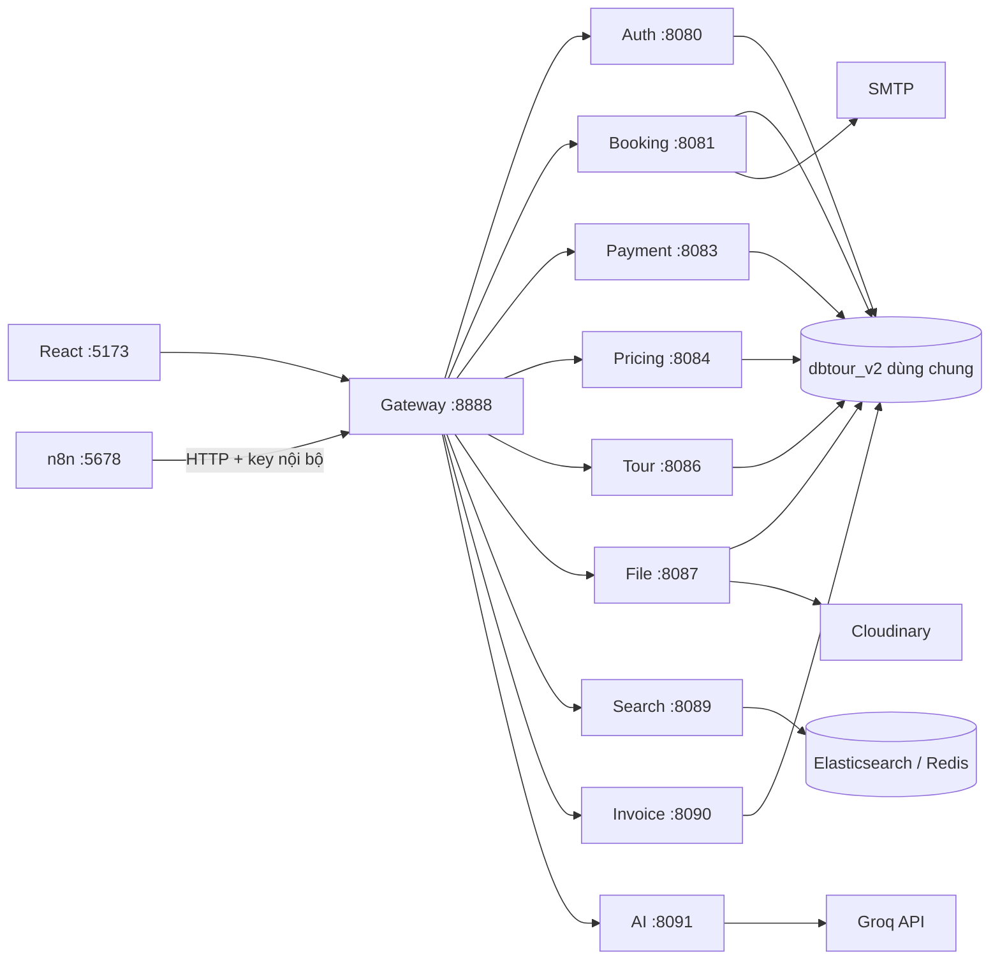

# SGU Tour — Tổng quan hệ thống

Đồ án J2EE hỗ trợ tìm tour, đặt chỗ, thanh toán VNPay sandbox, quản lý tour và tư vấn bằng AI. Giao diện hướng tới sử dụng trên laptop/PC. Tài liệu đối chiếu với source ngày **01/11/2026**; đặt trong repo backend, còn mã giao diện ở repo `Frontend_TourDuLich` cạnh đó.

## Chức năng hiện có

- Tài khoản: đăng ký/đăng nhập, JWT và làm mới phiên, Google Sign-In khi cấu hình OAuth, hồ sơ/avatar, role và quyền theo API; quản trị khóa, mở khóa, lưu trữ hoặc xóa tài khoản đủ điều kiện.
- Tour: danh mục, chi tiết, lịch trình, địa điểm, phương tiện, bảng giá theo nhóm tuổi, lịch khởi hành và số chỗ. Giá người lớn là giá chuẩn cho hiển thị/tìm kiếm; thanh toán tính theo từng hành khách.
- Booking: danh sách người đi, giữ/trả chỗ có hạn, hóa đơn, lịch sử đặt tour và đánh giá sau chuyến đi đủ điều kiện.
- VNPay: tạo giao dịch, kiểm tra callback/IPN và số tiền, xử lý lặp, quản lý giao dịch cần đối soát.
- Dời lịch: khách đã trả tiền gửi yêu cầu trước giờ đi tối thiểu 72 giờ; shop có luồng dời do lý do bắt buộc, phản hồi của khách và xử lý trường hợp cần hỗ trợ/hoàn tiền. Ghi nhận hoàn tiền nội bộ không tự chuyển tiền qua ngân hàng.
- Ảnh: upload từ trang admin qua file service lên Cloudinary, lưu URL/public ID, quản lý gallery/avatar và giới hạn ảnh đầu vào.
- Thông báo: Spring Email gửi từ outbox sau thao tác nghiệp vụ; n8n gọi API nội bộ để lập lượt nhắc thanh toán/khởi hành.
- AI: Spring AI gọi Groq, tìm/so sánh/đọc chi tiết tour theo dữ liệu backend, nhớ tiêu chí trong phiên, trả lời chính sách và tra cứu hạn booking của chính tài khoản.

## Kiến trúc và công nghệ

Backend gồm các ứng dụng Spring Boot độc lập, giao tiếp REST qua gateway/HTTP. **Các service nghiệp vụ hiện dùng chung database `dbtour_v2`** và có một số transaction/JDBC đọc nhiều bảng để bảo đảm số chỗ, tiền và lịch sử. Đây là kiến trúc chia service với shared database, chưa phải database-per-service; không có cam kết đã triển khai hệ phân tán production.

| Thành phần | Công nghệ trong source |
|---|---|
| Frontend | React 19, TypeScript 5.8, Vite 7, Ant Design 5, Redux Toolkit, Tailwind CSS 4 |
| Backend nghiệp vụ / gateway | Java 21, Spring Boot 3.2.5, Spring Cloud 2023.0.1, Security, JPA/JDBC, OpenFeign |
| AI | Spring Boot 3.5.16, Spring AI 1.1.8, Groq API |
| Database | MySQL JDBC; bản import đã kiểm chứng trên XAMPP MariaDB 10.4.32 |
| Tìm kiếm | Elasticsearch 8.15.0, Redis 7.2; đồng bộ snapshot từ tour service |
| Tích hợp | VNPay sandbox, Cloudinary, SMTP, n8n; Socket.IO trong auth service |



Sơ đồ thể hiện các thành phần chính, không liệt kê mọi lời gọi nội bộ. AI đọc API tour/booking, không kết nối SQL trực tiếp. Frontend Socket.IO kết nối riêng tới auth service ở cổng 8099.

## Service và cổng local

| Module | Cổng | Context-path | Lớp chạy trong IDE |
|---|---:|---|---|
| auth_service | 8080; Socket.IO 8099 | `/auth` | AuthServiceApplication |
| booking_service | 8081 | `/booking` | BookingServiceApplication |
| payment_service | 8083 | `/payment` | PaymentServiceApplication |
| pricing_service | 8084 | `/pricing` | PricingServiceApplication |
| tour_service | 8086 | `/tour` | TourServiceApplication |
| file_service | 8087 | `/file` | FileServiceApplication |
| search_service | 8089 | `/search` | SearchServiceApplication |
| invoice_service | 8090 | `/invoice` | InvoiceServiceApplication |
| ai_service | 8091 | `/ai` | AiServiceApplication |
| api_gateway | 8888 | Không có | ApiGatewayApplication |

Frontend gọi `http://localhost:8888/api/v1/<context>/...`; gateway bỏ hai đoạn `/api/v1`. Hai route notification:8082 và schedule:8085 đã được xóa khỏi cấu hình gateway vì không có module triển khai; không cần khởi động hai service này. n8n:5678 là container khai báo sẵn trong `docker-compose.yml` của repo backend, bật bằng `--profile mail`, không phải chatbot backend.

## Chạy local từ đầu

### 1. Công cụ

- JDK 21 và Maven 3.9.x; các module cũ có Maven wrapper, AI dùng Maven/IDE.
- Node đáp ứng engine của Vite 7: `^20.19.0 || >=22.12.0`, cùng npm.
- MySQL/XAMPP đang chạy; Docker Desktop nếu dùng Elasticsearch, Redis hoặc n8n qua container.
- Mỗi service là một project Maven riêng, không có lệnh Maven aggregate ở thư mục Backend.

Kiểm tra nhanh môi trường trước khi mở service (chỉ đọc, không in giá trị bí mật), chạy tại thư mục Backend_TourDuLich:

```powershell
powershell -ExecutionPolicy Bypass -File scripts\check-env.ps1
```

Script báo phiên bản JDK/Maven/Node, MySQL 3306, Docker và cú pháp compose, các key bắt buộc (trong `.local`, `.env`, environment, hoặc `%LOCALAPPDATA%\J2eeTourMail\config.json` do `Setup-MailLocal.ps1` tạo), cùng cổng nào đang bị chiếm. Phần cuối kiểm tra cổng 80 (nginx), 9200 (Elasticsearch), 6379 (Redis) nhưng chỉ cảnh báo khi container tương ứng đang chạy, nên không báo động khi bạn chạy service bằng IDE. Dùng `-SkipDocker`, `-SkipDependencies` hoặc `-SkipSearch` khi chỉ muốn kiểm tra một phần.

### 2. Database: import một lần

Import **[data_seed/database_all.sql](../data_seed/database_all.sql)** vào **dbtour_v2 mới/trống**, trước khi mở service ghi dữ liệu. Không có migration riêng, không import lại mỗi lần bật XAMPP. Database đang có dữ liệu thì không import lại; xem [hướng dẫn database](../data_seed/README.md) để biết phạm vi và cách kiểm tra.

File chứa 31 bảng hiện tại, 15 tour, giá/ảnh/lịch trình, 10 khách demo và các booking/chứng từ/review quá khứ–tương lai. Lịch mới phủ thứ Tư/Sáu/Chủ Nhật đến hết tháng 1 năm sau, tính theo ngày import. Lần kiểm chứng 27/10 có 715 lịch, 28 booking và 15 review. File chặn database đã có bảng; không dùng để merge vào DB đang chạy. Xem [hướng dẫn database](../data_seed/README.md).

| Tài khoản demo | Mật khẩu |
|---|---|
| admin@example.com | admin123 |
| user1@gmail.com … user10@gmail.com | user12345 |

Các Gmail trên là định danh demo, không phải hộp thư được phép gửi thử. Khách cũ trong snapshot giữ mật khẩu cũ.

### 3. Cấu hình backend

Các service có DB mặc định trỏ `jdbc:mysql://localhost:3306/dbtour_v2`, username `root`; JPA `ddl-auto=none` không tự sửa schema. Các biến cấu hình được liệt kê bên dưới.

Có thể đặt environment trong IDE hoặc dùng `.local/<module>.properties` đang được `spring.config.import` nạp. File local/config key không phải tài nguyên đưa lên repo.

| Biến / property | Module cần | Ý nghĩa |
|---|---|---|
| `DB_PASSWORD` | Bảy service có datasource | Mật khẩu DB local, có thể rỗng nếu DB local của bạn thực sự không đặt mật khẩu |
| `JWT_SIGNER_KEY` | Auth và các service nghiệp vụ xác minh JWT | Cùng khóa HS512, tối thiểu 64 byte UTF-8, giữ cục bộ |
| `GOOGLE_CLIENT_ID` | Auth | Audience của Google ID token; mặc định là client demo, override khi dùng OAuth client khác |
| `DB_URL` | Bảy service có datasource | URL JDBC, mặc định `jdbc:mysql://localhost:3306/dbtour_v2`; compose trỏ `host.docker.internal` |
| `DB_POOL_MAX`, `DB_POOL_MIN` | Bảy service có datasource | Kích thước Hikari pool (mặc định 10/2). Bảy service dùng chung một MySQL nên tổng pool phải thấp hơn `max_connections` (151) |
| `DB_POOL_TIMEOUT_MS` | Bảy service có datasource | Thời gian chờ kết nối trước khi báo lỗi (mặc định 10000 ms) |
| `JAVA_XMX` | Container backend | Nới heap cho mọi container Docker khi máy nhiều RAM (ví dụ `512m`–`1g`); để trống dùng mặc định trong Dockerfile |
| `TOUR_IMAGE_REFRESH_INTERVAL_MS` | Tour | Chu kỳ đối soát snapshot ảnh tour (mặc định 300000 ms). Upload/sửa tour cập nhật snapshot ngay, chu kỳ này chỉ để chỉnh sai lệch |
| `TOUR_RANDOM_TTL_MS` | Tour | Cache widget 3 tour ngẫu nhiên ở trang chủ; mặc định 0 = random mới mỗi lần tải |
| `TOUR_IMAGE_SNAPSHOT_FILE` | Tour | Đường dẫn snapshot ảnh tour (mặc định `data/tour-images.json`); compose trỏ vào volume để ảnh còn sau khi rebuild |
| `SEARCH_SYNC_DELAY_MS`, `SEARCH_SYNC_INITIAL_DELAY_MS` | Search | Chu kỳ đồng bộ danh mục (mặc định 60000 ms) và độ trễ lần đầu (2000 ms). `POST /search/tours/sync` vẫn ép đồng bộ ngay khi cần |
| `ES_URIS`, `REDIS_HOST`, `REDIS_PORT` | Search | Địa chỉ Elasticsearch/Redis (mặc định `http://localhost:9200`, `localhost`, `6379`); compose trỏ tên service nội bộ bằng property Spring chuẩn `SPRING_ELASTICSEARCH_URIS`/`SPRING_DATA_REDIS_HOST`, cả hai cách đặt đều có hiệu lực |
| `MAIL_POLL_DELAY_MS` | Booking | Nhịp thăm outbox SMTP (mặc định 5000 ms); mỗi lượt vẫn xử lý cả batch |
| `SPRING_DATASOURCE_URL`, `SPRING_DATASOURCE_USERNAME` | Service có datasource | Override URL/user bằng property Spring chuẩn khi cần |
| `VNPAY_HASH_SECRET`, `VNPAY_TMN_CODE` | Payment | Bắt buộc: payment_service từ chối khởi động nếu thiếu một trong hai (không dùng secret hard-code) |
| `VNPAY_RETURN_URL`, `VNPAY_PAY_URL` | Payment | URL trả về và endpoint thanh toán; mặc định là bộ sandbox demo |
| `CORS_ALLOWED_ORIGINS` | Gateway | Danh sách origin được phép, phân tách bằng dấu phẩy; mặc định các cổng dev của Vite |
| `AUTH_LOGIN_LIMIT`, `AUTH_REGISTER_LIMIT`, `AUTH_GOOGLE_LIMIT`, `AUTH_REFRESH_LIMIT`, `AUTH_PASSWORD_CHANGE_LIMIT` | Gateway | Số lượt mỗi IP mỗi phút cho từng endpoint trước khi nhận 429 (mặc định 20/5/10/30/10); mỗi endpoint có bucket riêng |
| `AUTH_CONNECT_TIMEOUT_MS`, `AUTH_RESPONSE_TIMEOUT_MS` | Gateway | Timeout gọi auth khi introspect JWT (mặc định 2000/3000 ms); quá hạn/auth sập trả 503 |
| `AUTH_BREAKER_FAILURES`, `AUTH_BREAKER_OPEN_MS` | Gateway | Ngưỡng lỗi liên tiếp và thời gian mở mạch (mặc định 5 lỗi / 10 giây); khi mở, gateway trả 503 ngay mà không gọi auth |
| `AUTH_BASE_URL`, `AUTH_INTROSPECT_CACHE_SECONDS` | Gateway | Địa chỉ auth và thời gian cache kết quả introspect (mặc định `http://localhost:8080`, 10 giây) |
| `CLOUDINARY_API_KEY`, `CLOUDINARY_API_SECRET` | File | Upload/quản lý ảnh; cloud-name theo `cloudinary.cloud-name` |
| `FILE_DOWNLOADS_PER_MINUTE` | File | Giới hạn số lượt gọi `/media/download/**` theo IP mỗi phút (mặc định 60; đặt 0 để tắt khi có CDN) |
| `MOMO_PARTNER_CODE`, `MOMO_ACCESS_KEY`, `MOMO_SECRET_KEY` | Payment | Credential MoMo AIO v2, tuỳ chọn: thiếu thì checkout MoMo báo "chưa cấu hình" chứ service vẫn khởi động. `MOMO_PAY_URL`, `MOMO_RETURN_URL`, `MOMO_IPN_URL` override endpoint mặc định |
| `MAIL_*` | Booking; internal key còn cần gateway | SMTP, test mode và API n8n; xem README mail |
| `GROQ_API_KEY`, `AI_*` | AI | Provider và tùy chọn AI; xem README ai_service |

Nơi dùng chung thuận tiện là `.local/` ở thư mục Backend:

```text
.local/
├── auth_service.properties
├── booking_service.properties
├── payment_service.properties
├── pricing_service.properties
├── tour_service.properties
├── file_service.properties
├── invoice_service.properties
└── search_service.properties
```

Ví dụ cấu trúc file local, cần thay placeholder cục bộ trước khi dùng, không ghi đè file đang có:

```properties
DB_PASSWORD=<mat-khau-mysql-local>
JWT_SIGNER_KEY=<cung-mot-khoa-ngau-nhien-toi-thieu-64-byte-cho-cac-service>
# Chỉ thêm nếu cần đổi mặc định:
# spring.datasource.url=jdbc:mysql://127.0.0.1:3306/dbtour_v2
# spring.datasource.username=root
```

Riêng `.local/payment_service.properties` cần thêm hai khóa VNPay bắt buộc và credential MoMo nếu muốn bật MoMo:

```properties
VNPAY_HASH_SECRET=<secret-sandbox-vnpay>
VNPAY_TMN_CODE=<tmn-code-sandbox-vnpay>
# Tuỳ chọn, chỉ cần khi bật thanh toán MoMo:
# MOMO_PARTNER_CODE=<partner-code>
# MOMO_ACCESS_KEY=<access-key>
# MOMO_SECRET_KEY=<secret-key>
```

File service thêm Cloudinary credential. Gateway không tự import các file `.local/<module>.properties`: truyền `MAIL_INTERNAL_API_KEY` vào môi trường gateway khi bật workflow; chỉ AI có bộ nạp riêng `GROQ_API_KEY` từ `.env`.

VNPay cần secret tương ứng merchant sandbox; upload mới cần Cloudinary credential; SMTP/Groq chỉ bật theo cấu hình riêng. Backend payment có sẵn MoMo AIO v2 (tạo thanh toán, return, IPN) nhưng là tính năng tuỳ chọn: thiếu `MOMO_*` thì checkout MoMo báo "chưa cấu hình" và service vẫn khởi động. Frontend hiện chỉ nối luồng VNPay, nên demo chính không cần MoMo. Không thay nội dung `.env`/`.local` đã có chỉ để chạy lại ứng dụng.

### 4. Hạ tầng và service

Chạy Elasticsearch/Redis tại `search_service`:

```powershell
docker compose up -d elasticsearch redis
```

Search tự thử đồng bộ danh mục từ tour service khi khởi động và định kỳ khoảng 60 giây; gọi `POST /search/tours/sync` (cần quyền `SEARCH_SYNC`) để ép đồng bộ ngay. Khi gọi catalog ngoài loopback (chẳng hạn Docker), đặt cùng khóa `CATALOG_INTERNAL_KEY` cho tour/auth và `SEARCH_SOURCE_KEY` cho search; để trống chỉ chấp nhận lời gọi loopback.

Chạy từng module trong IDE hoặc từng terminal, ví dụ tại `auth_service`:

```powershell
mvn spring-boot:run
```

Thứ tự thuận tiện: MySQL → Elasticsearch/Redis → auth, pricing, file, tour → booking, invoice, payment → search, AI → gateway → frontend. Đây là thứ tự giúp giảm lỗi phụ thuộc khi mở lần đầu, không phải hệ thống tự điều phối service.

Hoặc chạy toàn bộ bằng Docker tại thư mục Backend_TourDuLich (MySQL vẫn chạy ngoài Docker):

```powershell
docker compose up -d --build
# Kèm tìm kiếm / AI:
docker compose --profile search --profile ai up -d --build
```

Compose dựng frontend Nginx (cổng 80), gateway (8888), 7 service nghiệp vụ (search, AI và n8n chạy qua profile) và healthcheck từng container; bí mật đọc từ `.local/*.properties`, DB nối qua `host.docker.internal`. Ở profile mặc định chỉ publish gateway (8888), Socket.IO (8099) và frontend (80), tất cả gắn `127.0.0.1`; riêng 8099 buộc loopback vì cổng này bỏ qua gateway, còn nginx vẫn gọi `auth_service:8099` trong mạng compose. Profile `search` mở thêm Elasticsearch (9200) và Redis (6379); profile `mail` mở n8n (5678), cũng chỉ loopback.

Giới hạn heap container có thể cấu hình bằng `JAVA_XMX`; để trống dùng mặc định trong Dockerfile. Mỗi module có `.dockerignore` loại `target/`, `.git/`, log, IDE và `.env*` khỏi build context.

AI chạy như Spring Boot bình thường. Copy `.env.example` thành `.env` **nếu chưa có**, điền Groq key cục bộ trong module AI; không cần PS1 hay model local. Container AI chỉ là tuỳ chọn qua profile `ai`, khi đó phải đặt cả `GROQ_API_KEY` và `AI_ENABLED=true` trong environment (compose mặc định `AI_ENABLED=false`). Xem [README AI service](../ai_service/README.md).

### 5. Frontend

Tại `Frontend_TourDuLich`:

```powershell
npm ci
# Chỉ copy khi chưa có .env, sau đó chỉnh file cục bộ:
if (-not (Test-Path -LiteralPath .env)) { Copy-Item .env.example .env }
npm run dev
```

Điền `VITE_API_URL=/api/v1` (Vite proxy `/api` sang gateway cổng 8888), `VITE_PAGE_SIZE=10`; tùy chọn `VITE_SOCKET_URL=http://localhost:8099` cho dev và Google Client ID; production để trống `VITE_SOCKET_URL` để dùng origin hiện tại. Frontend mặc định tại `http://localhost:5173`; cần giữ cổng này đúng callback VNPay đang cấu hình. Xem [README frontend](../../Frontend_TourDuLich/README.md).

### 6. Email và n8n

Theo [hướng dẫn mail hiện tại](mail/README.md). Spring gửi thư từ booking service; n8n chỉ lập lượt nhắc qua HTTP và key nội bộ. SQL tổng đã có các bảng cần thiết, không thêm SQL mail. Giữ test mode với hộp thư do bạn kiểm soát khi demo. Chạy n8n trong mạng compose bằng `docker compose --profile mail up -d n8n` (editor tại `http://127.0.0.1:5678`); workflow mẫu gọi `http://api_gateway:8888`, không dùng `localhost`/`host.docker.internal`.

## Kiểm tra và demo

Frontend:

```powershell
npm run lint
npm run build
npm test
```

Backend, tại module cần kiểm tra:

```powershell
mvn '-Dtest=*Test' test
```

Đây là nhóm test có tên kết thúc `Test`, không đồng nghĩa đã chạy mọi bài `*Tests`/integration/SMTP thật. Các test cần DB/provider riêng có điều kiện kích hoạt; xem nguồn test và README từng phần. Lượt cập nhật README không tự chạy giao dịch, gửi mail hay gọi Groq thật.

Luồng demo gợi ý: khách tìm tour → đặt/chọn hành khách → xem đúng tổng tiền → thanh toán VNPay sandbox → xem hóa đơn/lịch sử → gửi yêu cầu dời lịch hợp lệ; admin quản lý lịch/chỗ, ảnh, tài khoản và đối soát theo quyền. Với AI, thử tìm miền Trung/ngân sách rồi giảm ngân sách ở lượt sau, xem chính sách và hỏi hạn booking của tài khoản đang đăng nhập.

## Giới hạn và vận hành

- VNPay là luồng thanh toán duy nhất được nối ra UI và kiểm thử end-to-end. Backend có endpoint MoMo AIO v2 và bảng `momo_transaction`, nhưng cần credential test và chưa có màn hình thanh toán MoMo, nên đừng demo MoMo như luồng hoàn chỉnh.
- n8n, backend, DB và worker phải đang chạy để tác vụ thực hiện. Khi máy tắt không có gửi mail tự động; bật lại xử lý mốc/hạn còn phù hợp, không tự gia hạn booking.
- Workflow nhắc mail phân trang theo cursor tới `maxPages` (batch 50); một booking lỗi không làm dừng cả lượt quét mà được đếm trong `failed` và trả code 1500. Chỉ lỗi hạ tầng mới trả 5xx để n8n retry. Import `docs/mail/n8n-error-handler.workflow.json` và gắn vào **Settings → Error Workflow** để nhận cảnh báo lỗi.
- Workflow mẫu mặc định `dryRun: true` và **chưa active**: tính năng nhắc tự động thực tế đang tắt cho tới khi đổi `dryRun` thành false và Publish workflow. Đây là chủ ý an toàn, không phải lỗi cấu hình.
- Đăng nhập bị giới hạn theo IP tại gateway (mặc định 20 lần/phút, trả 429 + `Retry-After`). Đây là chống dò mật khẩu cơ bản trong bộ nhớ một tiến trình, không thay thế WAF/IdP hay rate-limit phân tán khi chạy nhiều instance gateway.
- Hội thoại AI lưu RAM, TTL mặc định 30 phút; restart service mất phiên. Có validation và giới hạn gọi, không có quyền chạy SQL/code hay thực hiện đặt tour/thanh toán.
- Chưa có dashboard quản lý mail trong admin; theo dõi outbox/log và n8n Executions. SENT nghĩa SMTP chấp nhận, không chứng minh đã vào inbox/được đọc.
- Frontend có `npm test` (Node test runner) và workflow `../../Frontend_TourDuLich/.github/workflows/frontend-ci.yml`: `npm ci` → lint → build → test trên mỗi push/PR. Backend có workflow `../.github/workflows/backend-ci.yml` ở gốc repo backend: test ma trận 10 module, kiểm tra cú pháp `docker-compose.yml` và import `data_seed/database_all.sql` trên MariaDB 10.4 + MySQL 8.0 vào DB trống. File seed là bản tổng duy nhất, không còn migration riêng; job database kiểm tra schema/dữ liệu nền sau import.
- Cả 10 module backend và frontend đều có Dockerfile; `docker-compose.yml` ở gốc repo backend chạy được toàn bộ hệ thống với MySQL trên host (cần checkout repo frontend cạnh nó). Các callback VNPay, CORS và domain Cloudinary vẫn cần chỉnh theo tên miền thật khi deploy (dùng `PUBLIC_BASE_URL`); compose không thay thế cấu hình production.
- `.local/recovery` và `.local/backups` là dữ liệu cứu/sao lưu MySQL, không cần để runtime chạy. SQL trong `src/test/resources` chỉ dùng cho kiểm thử.

## Quy ước dữ liệu backend

- Bảy service có datasource đặt `spring.jpa.open-in-view=false`. Map DTO chứa quan hệ LAZY bên trong transaction hoặc nạp sẵn bằng `@EntityGraph`/`fetch join`; controller không serialize quan hệ chưa được nạp.
- Đặt lời gọi HTTP ra service khác ngoài transaction để không giữ kết nối DB trong lúc chờ mạng.
- Pool mặc định 10/2 mỗi service, thời gian chờ kết nối 10 giây; tổng giới hạn pool phải thấp hơn `max_connections` của MySQL.

## Quy tắc nghiệp vụ khi demo

- Booking `CONFIRMED` không đồng nghĩa đã trả tiền; kiểm tra reservation, payment, invoice và giao dịch của cổng thanh toán.
- Còn hơn 7 ngày lịch: hạn thanh toán là min(ngày đặt + 6 ngày, ngày đi − 6 ngày), lúc 08:00 Việt Nam. Nhắc ngày đặt + 3 nếu không quá hạn − 1; mốc còn lại là hạn − 1, gộp nếu trùng. Còn tối đa 7 ngày: checkout tối đa 15 phút, không vượt giờ đi.
- Worker backend giữ/trả chỗ khi hết hạn; tắt mail không tắt worker. n8n không quyết định số ghế hay trạng thái thanh toán.
- Khách đã thanh toán chỉ yêu cầu dời trước giờ đi ít nhất 72 giờ. Dời do shop phải có lý do và xử lý từng booking; ghi nhận hoàn tiền không tự chuyển tiền ngân hàng.
- Tài khoản có `ACTIVE`/`LOCKED`/`ARCHIVED`; chỉ xóa thật tài khoản đã khóa, không có lịch sử nghiệp vụ. Tài khoản có lịch sử được lưu trữ thay vì xóa.
- Thay đổi vai trò tài khoản hoặc sửa/gỡ quyền của vai trò làm tăng `sessionEpoch` của tài khoản bị ảnh hưởng trong cùng transaction, khiến JWT cũ hết hiệu lực. Chỉ cấp thêm quyền thì nhận quyền mới ở lần refresh tiếp theo.
- Upload tour: tối đa 10 ảnh/lượt, 5 MiB/ảnh, tổng 25 MiB; avatar tối đa 2 MiB. API kiểm tra chữ ký và kích thước pixel JPEG/PNG/WebP, không nhận SVG tải lên.

## Tài liệu

- [Backend](../README.md) · [Frontend](../../Frontend_TourDuLich/README.md) · [Database](../data_seed/README.md).
- [AI](ai/README.md) · [Email/n8n](mail/README.md).
- [Nguồn dữ liệu tour](DATA_SOURCES.md).
