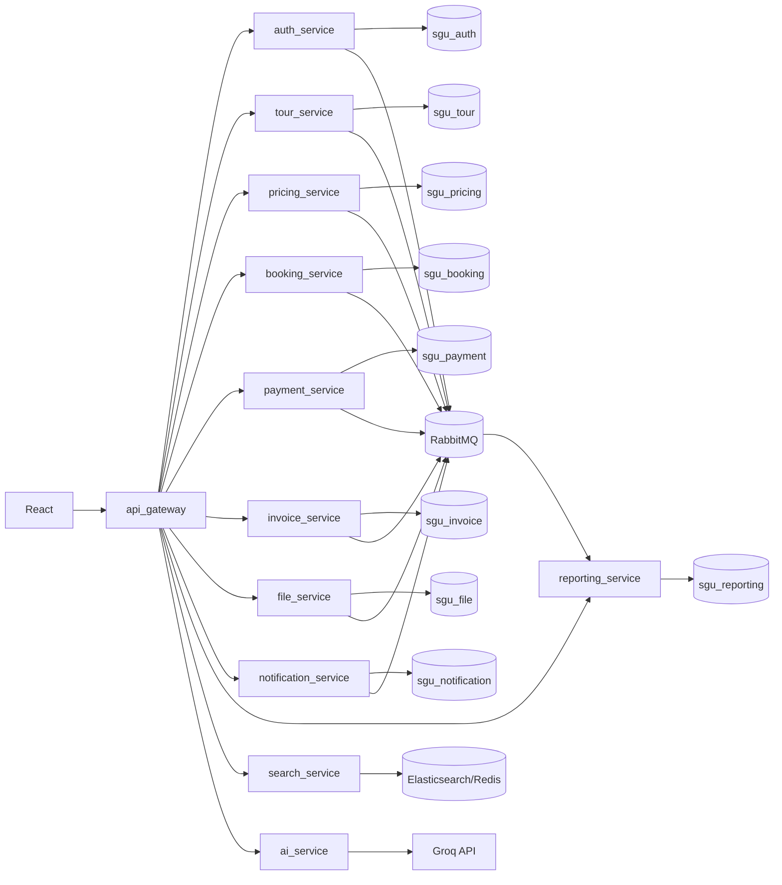

# Roadmap chuyển SGU Tour sang microservice 9 database

> Tài liệu này là nguồn tham chiếu chính cho giai đoạn chuyển kiến trúc.
> Mục tiêu cuối cùng là **9 database vật lý độc lập**, không phải một MySQL chứa 9 schema.
> Mọi thay đổi lớn phải cập nhật lại tài liệu này trước khi triển khai.

## 1. Mục tiêu

- Tách `dbtour_v2` thành 9 database thuộc 9 service:
  `sgu_auth`, `sgu_tour`, `sgu_pricing`, `sgu_booking`, `sgu_payment`,
  `sgu_invoice`, `sgu_file`, `sgu_notification`, `sgu_reporting`.
- Mỗi service chỉ đọc/ghi database của mình. Không query, không JOIN, không khóa,
  không transaction và không foreign key xuyên database.
- Các luồng cần nhất quán giữa nhiều service dùng **internal API + RabbitMQ event**,
  transactional outbox, inbox idempotency và saga/compensation.
- Giữ được luồng nghiệp vụ hiện tại: đặt tour, giữ chỗ, thanh toán VNPay/MoMo,
  hóa đơn, đổi lịch/hoàn tiền, đánh giá, upload ảnh, email, AI và báo cáo vận hành.
- Local 8 GB chạy tuần tự từng nhóm; AWS 16 GB chạy toàn bộ để test E2E.

## 2. Nguyên tắc không thương lượng

1. **Database-per-service**: mỗi DB có user riêng, grant riêng, migration riêng.
2. **Không cross-database SQL**: không `dbtour_v2.booking`, không `JOIN` bảng của service khác.
3. **Không distributed transaction/2PC**: dùng outbox + event + saga.
4. **Idempotency bắt buộc**: callback thanh toán, event tiêu thụ, retry HTTP.
5. **Không đọc DB nguồn để làm báo cáo**: reporting chỉ đọc read model của mình.
6. **Search/AI không có DB nghiệp vụ**: chỉ gọi API hoặc dùng snapshot/read model.
7. **Dữ liệu lịch sử không bị ghi đè**: booking, payment, invoice, audit phải giữ vết.
8. **Thay đổi theo vertical slice**: mỗi lát cắt phải chạy được, có test và rollback.
9. **Không đưa secret vào repo**: `.local/`, `.env`, credential thật không được commit.
10. **Không big-bang cutover**: giữ `dbtour_v2` làm nguồn đối chiếu đến hết Phase 5.

## 3. Hiện trạng và blocker

### 3.1 Hiện trạng

- Các service Spring Boot đang dùng chung `dbtour_v2`.
- Một số luồng dùng chung transaction/JDBC nhiều bảng, nên không thể tách DB bằng cấu hình.
- Gateway, auth, tour, pricing, booking, payment, invoice, file, search, AI đã là các
  tiến trình riêng nhưng chưa sở hữu dữ liệu riêng.
- `notification` và `reporting` chưa có service độc lập.

### 3.2 Blocker phải xử lý trước khi tách DB

| Blocker | Vị trí hiện tại | Hướng xử lý |
|---|---|---|
| Booking đọc/khóa `tour_departure` trực tiếp | `booking_service/.../BookingLifecycleService.java`, `ReservationExpiryService.java`, `ChangeLedger.java` | Tour sở hữu ghế; booking gọi internal API giữ/trả ghế hoặc dùng `departure_hold` + event |
| Booking đọc `prices`, `tour`, `users` trực tiếp | `BookingLifecycleService.java`, `BookingChangeService.java`, `ChangeLedger.java`, `ReminderStateReader.java` | Pricing/tour/auth cung cấp internal API hoặc projection |
| Payment đọc `prices`, `tour`, `booking` trực tiếp | `VnPayOrderService.java`, `MoMoService.java` | Payment chỉ giữ dữ liệu thanh toán; quote lấy từ pricing/booking API |
| Invoice/payment đọc chéo khi settlement | `VnPayOrderService.java`, `MoMoOrderService.java`, `ReconciliationService.java` | Saga payment → invoice; mỗi bên ghi DB của mình |
| Auth đọc booking/payment/invoice/file để archive/delete | `AccountLifecycleService.java`, `AvatarProfileWriter.java` | Gọi internal API/event; file service sở hữu `file_mgmt` và lock avatar |
| Tour đọc booking/payment/invoice để tính sức chứa | `DepartureCapacityReader.java` | Booking/payment/invoice phát event; tour giữ projection `departure_hold` |
| Booking join tour/user/payment/invoice cho AI | `BookingAdviceService.java` | Booking API tổng hợp qua internal API hoặc reporting read model |
| `OperationsInsights` join chéo 6 bảng | `booking_service/.../operations/OperationsInsights.java` | Chuyển sang `reporting_service` + `ops_*` read model |
| Mail outbox nằm trong booking/payment | `mail_outbox`, `PaymentMailOutboxWriter.java` | `notification_service` sở hữu outbox/template/delivery |
| Tour xóa ảnh bằng SQL vào `file_mgmt` | `tour_service/.../TourService.java` | Gọi file service, không ghi DB file |
| Auth/tour/book xóa hoặc kiểm tra `file_mgmt` trực tiếp | auth/tour/booking | File service cung cấp API kiểm tra/xóa/cleanup |
| Search đọc snapshot tour | `search_service` | Giữ snapshot/event; không đọc DB tour trực tiếp |
| AI đọc tour/booking qua HTTP | `ai_service` | Giữ API-only; thêm contract test và timeout/fallback |

## 4. Kiến trúc đích



### 4.1 Database ownership

| Database | Service | Bảng sở hữu |
|---|---|---|
| `sgu_auth` | `auth_service` | `users`, `roles`, `permissions`, `permission_role`, `invalidated_token`, `user_account_event`, `reviews` |
| `sgu_tour` | `tour_service` | `tour`, `itinerary`, `location`, `vehicles`, `tour_departure`, `tour_image_ids`, `departure_meeting_point`, `departure_hold` |
| `sgu_pricing` | `pricing_service` | `prices` |
| `sgu_booking` | `booking_service` | `booking`, `customer`, `booking_reservation`, `booking_price_snapshot`, `booking_change`, `booking_change_event`, `departure_change` |
| `sgu_payment` | `payment_service` | `payment`, `vnpay_transaction`, `momo_transaction`, `payment_reconciliation`, `payment_reconciliation_event` |
| `sgu_invoice` | `invoice_service` | `invoice` |
| `sgu_file` | `file_service` | `file_mgmt`, `avatar_media_lock`, `tour_media_lock` |
| `sgu_notification` | `notification_service` | `mail_outbox`, template, delivery attempt, suppression |
| `sgu_reporting` | `reporting_service` | `operation_audit`, `ops_*` read models |

### 4.2 Bảng hạ tầng mới

Mỗi service có DB riêng cần tối thiểu:

- `<service>_outbox`: event sắp publish, ghi cùng transaction nghiệp vụ.
- `<service>_inbox`: event đã nhận, unique theo `(consumer, event_id)`.
- `saga_*`: trạng thái saga do orchestrator sở hữu.
- `sgu_tour.departure_hold`: ghế đang giữ theo booking, có TTL và version.
- `sgu_file.file_reference`: tham chiếu file từ tour/avatar/booking, thay cho cột logic rải rác.
- `sgu_reporting.ops_*`: projection phục vụ admin, không thay thế nguồn sự thật.

### 4.3 Event envelope

Mọi event dùng chung envelope:

```json
{
  "eventId": "uuid",
  "eventType": "booking.created.v1",
  "occurredAt": "2026-11-20T10:00:00+07:00",
  "producer": "booking_service",
  "aggregateType": "booking",
  "aggregateId": "123",
  "aggregateVersion": 1,
  "correlationId": "request-id",
  "causationId": "event-id-or-command-id",
  "payload": {}
}
```

Quy tắc:

- `eventId` là duy nhất toàn hệ thống.
- Consumer ghi inbox trước khi xử lý; event trùng bị bỏ qua.
- Payload chỉ chứa dữ liệu consumer cần; không gửi toàn bộ entity.
- Event không chứa secret, token, thông tin thanh toán nhạy cảm.
- Tên event có version: `payment.settled.v1`, `invoice.issued.v1`.

## 5. Event catalog ban đầu

| Event | Producer | Consumer | Mục đích |
|---|---|---|---|
| `auth.user.registered.v1` | auth | notification, reporting | Gửi welcome, thống kê |
| `auth.user.locked.v1` | auth | booking, reporting | Chặn thao tác mới, audit |
| `auth.user.archived.v1` | auth | booking, file, reporting | Dọn dữ liệu theo chính sách |
| `tour.departure.changed.v1` | tour | booking, search, reporting | Đổi lịch/giá/trạng thái |
| `tour.departure.cancelled.v1` | tour | booking, payment, notification | Mở luồng đổi lịch/hoàn |
| `tour.departure.hold.requested.v1` | booking | tour | Giữ ghế |
| `tour.departure.hold.released.v1` | booking | tour | Trả ghế |
| `booking.created.v1` | booking | notification, reporting | Email xác nhận, báo cáo |
| `booking.confirmed.v1` | booking | payment, notification, reporting | Cho phép thanh toán/hoàn tất |
| `booking.cancelled.v1` | booking | payment, notification, reporting | Hủy và hoàn |
| `booking.expired.v1` | booking | tour, payment, notification | Giải phóng ghế |
| `booking.change.requested.v1` | booking | notification, reporting | Thông báo yêu cầu đổi |
| `booking.change.approved.v1` | booking | payment, tour, notification | Đổi lịch/hoàn tiền |
| `payment.settled.v1` | payment | booking, invoice, reporting | Đã thu tiền |
| `payment.failed.v1` | payment | booking, notification, reporting | Thanh toán lỗi |
| `payment.refunded.v1` | payment | booking, invoice, notification, reporting | Đã hoàn |
| `invoice.issued.v1` | invoice | notification, reporting | Hóa đơn mới |
| `invoice.paid.v1` | invoice | reporting | Chốt doanh thu |
| `file.deleted.v1` | file | tour, auth, reporting | Dọn tham chiếu |
| `report.audit.recorded.v1` | auth/tour/pricing/booking | reporting | Audit timeline |

## 6. Luồng nghiệp vụ đích

### 6.1 Đặt tour và giữ chỗ

1. Booking nhận request, kiểm tra idempotency `clientKey`.
2. Booking gọi tour internal API `POST /internal/departures/{id}/holds` với số ghế, TTL.
3. Tour ghi `departure_hold` và giảm ghế trong transaction của tour, trả `holdId`.
4. Booking ghi booking + reservation + price snapshot trong DB booking.
5. Booking phát `booking.created.v1`.
6. Hết hạn: booking phát `booking.expired.v1`; tour nhận và giải phóng hold.
7. Payment/invoice không đọc DB booking; dùng event hoặc internal API.

### 6.2 Thanh toán → hóa đơn

1. Payment tạo giao dịch VNPay/MoMo trong DB payment.
2. Callback hợp lệ được xác thực chữ ký, idempotent theo `txnRef`.
3. Payment ghi `payment.settled.v1` vào outbox cùng transaction.
4. Booking nhận event, chuyển trạng thái; invoice nhận event, tạo hóa đơn.
5. Invoice phát `invoice.issued.v1` / `invoice.paid.v1`.
6. Notification nhận event để gửi mail; reporting cập nhật read model.
7. Nếu invoice lỗi, saga retry/DLQ; payment không tự ghi DB invoice.

### 6.3 Đổi lịch/hoàn tiền

1. Booking tạo `booking_change` + event.
2. Shop duyệt → saga orchestration:
   - giữ ghế đích ở tour;
   - tính chênh lệch qua pricing/booking API;
   - ghi payment refund nếu cần;
   - cập nhật booking và phát event;
   - nhả ghế nguồn.
3. Mỗi bước có compensation; trạng thái saga lưu DB của orchestrator.
4. Không dùng 2PC; mọi bước idempotent.

### 6.4 Tài khoản, avatar, media

1. Auth sở hữu user/role/review.
2. Auth gọi file internal API để khóa avatar, lấy URL, cleanup.
3. File phát `file.deleted.v1` để auth/tour cập nhật tham chiếu.
4. Auth không đọc `file_mgmt` trực tiếp.

### 6.5 Báo cáo vận hành

1. Auth/tour/pricing/booking/payment/invoice phát audit/event.
2. Reporting consume, ghi `ops_*` read model.
3. Admin API đọc reporting; không join DB nguồn.
4. UI hiển thị `lastUpdatedAt`; nếu lag thì báo thay vì query chéo.

## 7. Lộ trình triển khai

### Phase 0 — Baseline và hợp đồng

- Tạo tài liệu này, ADR database-per-service và ADR outbox/inbox.
- Lập bảng ownership, event catalog, internal API catalog.
- Cập nhật `docs/PROJECT.md`, `docs/DOCKER.md`, `data_seed/README.md` theo đích mới.
- Thêm script kiểm tra isolation: không có `REFERENCES` chéo DB, không có `dbtour_v2` trong code mới.
- **Gate**: tài liệu được review; chưa đổi runtime.

### Phase 1 — Hạ tầng (✅ Đã nghiệm thu)

- Thêm RabbitMQ và 9 MySQL độc lập vào compose microservice (`docker-compose.microservice.yml`).
- Tạo `data_seed/microservices/*.sql` cho từng DB (9 file: sgu_auth, sgu_tour, sgu_pricing, sgu_booking, sgu_payment, sgu_invoice, sgu_file, sgu_notification, sgu_reporting).
- Thêm outbox/inbox schema cho từng service (`<svc>_outbox`, `<svc>_inbox`).
- Thêm internal API contract (`docs/INTERNAL_API_CONTRACTS.md`).
- **Gate**: `docker compose -f docker-compose.microservice.yml config -q` PASS; từng DB khởi động độc lập (tested `sgu_auth` + `sgu_tour` + rabbitmq healthy trên máy 8GB); service test kết nối chỉ DB của mình (user/grant riêng).

**Kết quả nghiệm thu Phase 1**: PASS. 2 DB test được khởi động độc lập, user/grant riêng, outbox/inbox có trong schema, không cross-DB FK. Do máy 8GB, không test cùng lúc 9 DB; các DB khác có cấu trúc tương tự nên dự kiến pass.

**Lưu ý khi áp dụng Phase 2+**: Các file `.sql` đã tạo thủ công theo `docs/PHASE1_SCHEMA.md`. Các service Java vẫn đang dùng `dbtour_v2` (shared DB) — chưa chuyển `DB_URL` sang DB riêng (làm ở Phase 3).

### Phase 2 — Refactor vertical slices trên shared DB

Thứ tự đề xuất:

1. **Reporting** (mới): đọc event/audit, thay `OperationsInsights`.
2. **Notification** (mới): nhận event, sở hữu mail outbox.
3. **File**: bỏ SQL `file_mgmt` khỏi auth/tour/booking.
4. **Pricing**: bỏ join `prices` khỏi booking/payment; dùng pricing API.
5. **Tour**: capacity/hold API, event cho booking/search.
6. **Auth**: bỏ query booking/payment/invoice/file; dùng API/event.
7. **Booking**: bỏ join tour/user/payment/invoice; dùng API/projection.
8. **Payment**: settlement chỉ ghi DB payment; phát event.
9. **Invoice**: chỉ ghi DB invoice; consume payment event.
10. **Search/AI**: giữ API-only, thêm contract/timeout/fallback.

Mỗi slice phải:

- Có internal API/event rõ ràng.
- Có test đơn vị + test tích hợp với DB của service.
- Không làm tăng cross-domain SQL.
- Có feature flag nếu cần chuyển đổi.
- Có rollback bằng cấu hình hoặc revert commit.

### Phase 3 — Tách database vật lý

- Tạo 9 MySQL instance/container, user riêng, volume riêng.
- Chạy migration từng DB bằng `data_seed/microservices/*.sql`.
- Chuyển `DB_URL` từng service sang DB riêng.
- Bỏ cross-database FK; giữ FK nội bộ DB.
- Migrate dữ liệu theo thứ tự:
  `auth → tour → pricing → booking → payment → invoice → file → notification → reporting`.
- Kiểm tra count/sum/orphan/duplicate sau mỗi DB.
- **Gate**: service khởi động với chỉ DB của mình; cross-DB query bị từ chối bởi grant.

### Phase 4 — Saga và đồng bộ

- Implement outbox publisher + inbox consumer.
- Implement saga booking hold/expiry, payment/invoice, reschedule/refund.
- Retry có backoff, DLQ, replay có kiểm soát.
- Reporting projection + audit timeline.
- Notification template/delivery/retry.
- **Gate**: duplicate event/callback không tạo bản ghi trùng; consumer chết không mất event.

### Phase 5 — Cleanup và acceptance

- Xóa `dbtour_v2` khỏi cấu hình runtime sau khi đối chiếu.
- Xóa code/table/column legacy, mail outbox cũ, cross-domain reader.
- Cập nhật README, compose, CI, script demo.
- Chạy E2E trên AWS 16 GB.
- **Gate**: acceptance checklist bên dưới đạt 100%.

## 8. Chiến lược test

### 8.1 Local 8 GB

Không bật cả 9 MySQL + 9 Java cùng lúc. Chạy theo nhóm:

1. `sgu_auth` + `auth_service` + gateway tối thiểu.
2. `sgu_tour` + `sgu_pricing` + `tour_service` + `pricing_service`.
3. `sgu_booking` + `booking_service`.
4. `sgu_payment` + `sgu_invoice` + `payment_service` + `invoice_service`.
5. `sgu_file` + `file_service`.
6. `sgu_notification` + `sgu_reporting` + RabbitMQ.
7. `search_service`/`ai_service` với dependency ngoài.

Dừng nhóm trước khi sang nhóm sau. Không hạ xuống 1 MySQL 9 schema.

### 8.2 AWS 16 GB

- Bật toàn bộ 9 DB, RabbitMQ, 9 service, Elasticsearch/Redis, frontend.
- E2E: đăng ký/đăng nhập, tìm tour, đặt tour, VNPay callback, invoice, đổi lịch,
  hoàn tiền, review, upload avatar, admin operations, AI chat.
- Failure injection: kill consumer, duplicate callback, event trễ, DB restart.
- Kiểm tra backup/restore từng DB.

### 8.3 Test tự động

- Unit test theo module.
- Contract test internal API/event.
- Integration test với MySQL riêng của service.
- Isolation test: grant user không đọc được DB khác.
- Static test: không có `dbtour_v2`, `JOIN` bảng ngoài ownership trong code mới.

## 9. Migration dữ liệu

Với mỗi DB:

1. Tạo DB/user/grant.
2. Chạy schema `data_seed/microservices/<db>.sql`.
3. Export dữ liệu từ `dbtour_v2` chỉ với bảng thuộc DB.
4. Import, giữ nguyên ID.
5. Kiểm tra:
   - số bản ghi;
   - tổng tiền booking/payment/invoice;
   - orphan theo khóa logic;
   - duplicate theo unique key;
   - trạng thái booking/reservation/payment/invoice.
6. Chuyển service sang DB mới, chạy smoke test.
7. Giữ `dbtour_v2` read-only để đối chiếu.

Không xóa bảng khỏi `dbtour_v2` cho đến Phase 5.

## 10. Rollback

- Mỗi service có biến `DB_URL` riêng; rollback bằng cách trỏ lại DB cũ.
- Mỗi migration có backup trước khi chạy.
- Outbox/inbox có thể tắt consumer nhưng không xóa event.
- Saga có trạng thái `FAILED`/`COMPENSATING` để xử lý thủ công.
- Không rollback bằng cách xóa dữ liệu đã phát sinh.

## 11. Acceptance checklist

- [ ] 9 database vật lý độc lập, volume riêng.
- [ ] Mỗi service chỉ có grant trên DB của mình.
- [ ] Không còn cross-database query/FK/transaction.
- [ ] Không còn service đọc bảng ngoài ownership.
- [ ] Outbox/inbox hoạt động; event trùng không gây duplicate.
- [ ] Saga booking/payment/invoice/reschedule có compensation.
- [ ] Reporting không query DB nguồn.
- [ ] Notification sở hữu mail outbox/template/delivery.
- [ ] File service sở hữu toàn bộ metadata ảnh.
- [ ] Search/AI chỉ dùng API/snapshot.
- [ ] Local test tuần tự đạt; AWS E2E đạt.
- [ ] Docs, compose, CI, demo script khớp topology mới.
- [ ] Không có secret trong repo hoặc file mẫu.

## 12. Việc tiếp theo ngay sau tài liệu này

1. ✅ Review và chốt ownership/event catalog (`docs/PHASE0_BASELINE.md`).
2. ✅ Tạo compose 9 MySQL + RabbitMQ (`docker-compose.microservice.yml`).
3. ✅ Tạo schema từng DB từ `database_all.sql`, bỏ cross-db FK (`data_seed/microservices/*.sql`).
4. **Làm slice `reporting` trước để thay `OperationsInsights`** (Phase 2 slice #1).
5. **Làm slice `notification` để bỏ mail outbox khỏi booking/payment** (Phase 2 slice #2).
6. Tiếp tục theo thứ tự Phase 2 slices: File → Pricing → Tour → Auth → Booking → Payment → Invoice → Search/AI.
6. Tiếp tục theo thứ tự Phase 2.
